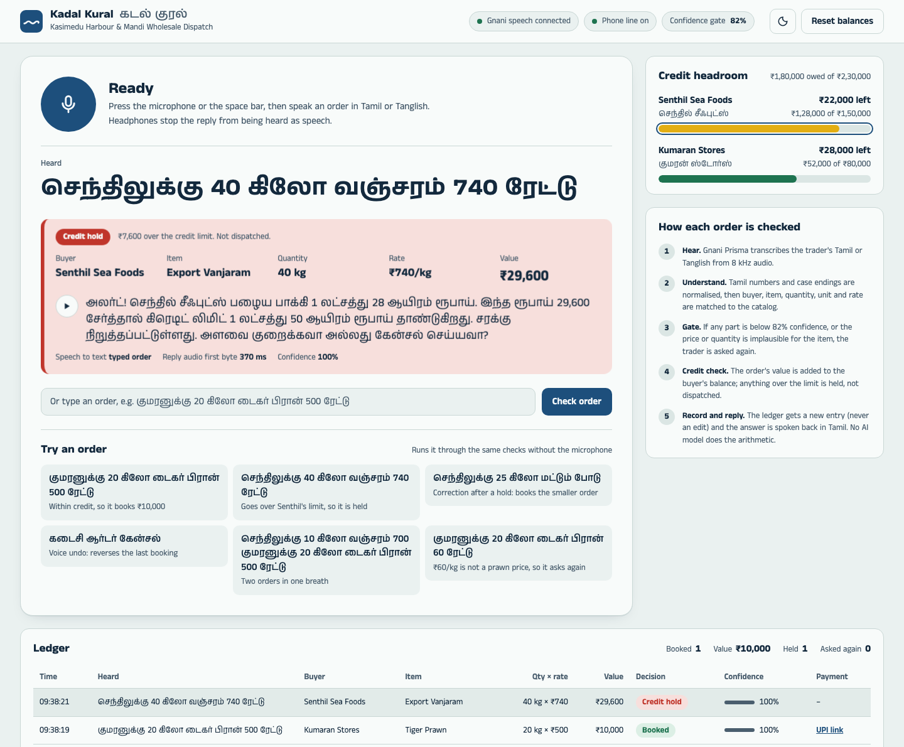
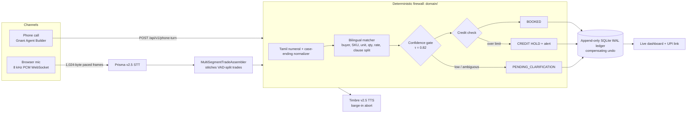

# Kadal Kural (கடல் குரல்): B2B Pre-Dispatch Credit Firewall

[](https://github.com/Nixon-CSE/kadal-kural/actions/workflows/ci.yml)

**A screen-free Tamil/Tanglish voice credit ledger that checks every order before dispatch, built for loud wholesale fish markets.**
A trader speaks an order ("குமரனுக்கு 20 கிலோ டைகர் பிரான் 500 ரேட்டு"). Kadal Kural books it, holds it for a credit-limit breach, or asks the trader to repeat it, and answers in spoken Tamil within about half a second. Built on the **Gnani AI Artha Stack**: Prisma v2.5 8 kHz streaming STT and Timbre v2.5 streaming TTS.



| Measured result (see [benchmark/REPORT.md](benchmark/REPORT.md)) | |
|---|---|
| Silent financial errors (wrong trades booked without a hold) | **0 of 560** noisy trades, 4 noise profiles at 10 and 5 dB SNR |
| Field accuracy, noisy (buyer / SKU / qty / rate) | 100% / 97.0% / 97.0% / 95.7% |
| Reply latency, first STT segment → first reply audio | P50 **392 ms** / P95 508 ms (was 1,828 ms) |
| Barge-in: interrupt → TTS stream stopped | P50 **52 ms** (24 live trials) |
| Firewall decision (normalize + match + gate + SQLite write) | P50 0.16 ms |

## Why

At a harbour auction, orders are shouted, dispatched on trust, and reconciled later. A misheard *500* booked as *50*, or a trade booked to the wrong buyer, costs real money. A missed credit limit costs more. Kadal Kural's job is that **no wrong trade is booked silently**: anything uncertain is held and the trader is asked again.

## Architecture



### Design decisions

1. **"STT extracts; code calculates."** No LLM ever extracts or computes an amount. Balances, credit holds and undo are deterministic code over an append-only ledger, and an undo is a compensating row, never a delete.
2. **Fail closed.** The overall confidence is the *minimum* of buyer, SKU, unit, quantity and rate. Quantity and rate are scored against per-unit catalog bands, so a misheard amount is caught by plausibility (Prisma reports no confidence; see [docs/itn_findings.md](docs/itn_findings.md)). Leftover numbers, unknown buyers and over-limit trades are held, and every hold gets a spoken reply.
3. **Tamil numerals are normalized before matching.** Hybrid word-plus-digit tokens (`எழுநூற்றி 40` → 740, `ஐநூற்றுக்கு 60` → 560) and dative endings (`-க்கு`, `-னுக்கு`) are resolved before bilingual phonetic matching.
4. **Clause splitting for one-breath orders.** A second buyer in the dative starts a new trade. Fuzzy (non-exact) buyer splits require both halves to be complete trades, so a word that only looks like a buyer can't book to the wrong account.
5. **Realtime protocol discipline.** 1,024-byte frames at the true 64 ms cadence. Complete trades commit at once, incomplete text waits. Barge-in aborts Timbre with a capped close handshake (1,056 ms → 52 ms).
6. **Measured, not claimed.** Every latency and accuracy number in this README comes from a script in [scripts/](scripts/) or [benchmark/](benchmark/), with its raw data checked in.

## Quick start

Requires Python 3.9+ and a Gnani API key for live speech. The tests and benchmark re-scoring need no key or network.

```bash
python -m venv .venv && source .venv/bin/activate
pip install -e ".[dev]"
cp .env.example .env            # set KADAL_GNANI_API_KEY
make run                        # http://localhost:8000
```

Open http://localhost:8000, allow the microphone (headphones recommended), press the microphone or the space bar and speak an order. You can also type one, or pick one under *Try an order*. Or use the API without a microphone:

```bash
curl -s localhost:8000/api/v1/ingest -H 'Content-Type: application/json' \
  -d '{"transcript": "குமரனுக்கு 20 கிலோ டைகர் பிரான் 500 ரேட்டு", "synthesize_tts": false}'
curl -s -X POST localhost:8000/api/v1/reset     # back to opening balances
```

Docker: `docker build -t kadal-kural . && docker run -p 8000:8000 --env-file .env kadal-kural` (non-root, healthcheck, ledger on the `/data` volume).

### Try these

Starting from opening balances (Senthil ₹1,28,000 of ₹1,50,000; Kumaran ₹42,000 of ₹80,000):

| Say | Result |
|---|---|
| குமரனுக்கு 20 கிலோ டைகர் பிரான் 500 ரேட்டு | Booked ₹10,000 |
| செந்திலுக்கு 40 கிலோ வஞ்சரம் 740 ரேட்டு | Credit hold, ₹7,600 over limit, spoken alert |
| *(over the alert)* செந்திலுக்கு 25 கிலோ மட்டும் போடு | Alert stops; booked ₹18,500 |
| கடைசி ஆர்டர் கேன்சல் | Last trade reversed |
| செந்திலுக்கு 10 கிலோ வஞ்சரம் 700 குமரனுக்கு 20 கிலோ டைகர் பிரான் 500 ரேட்டு | Two trades from one breath |
| குமரனுக்கு 20 கிலோ டைகர் பிரான் 60 ரேட்டு | Asks again: ₹60/kg is outside the prawn band |

## API

| Endpoint | Purpose |
|---|---|
| `WS /ws/live-audio` | Full-duplex browser audio: 8 kHz PCM in → decisions + Timbre audio out |
| `POST /api/v1/ingest` | Transcript in → firewall decisions (optional TTS) |
| `POST /api/v1/phone-turn` | Phone channel: Gnani Agent Builder On-Call action, token-authenticated ([docs/phone_channel.md](docs/phone_channel.md)) |
| `POST /api/v1/upload-wav` | WAV file → paced Prisma stream → decisions + replies |
| `GET /api/v1/state` | Balances and audit log, including what was heard per row |
| `POST /api/v1/reset` | Reset to catalog opening balances (demo) |
| `GET /healthz` | Liveness and whether a Gnani key is configured |

Interactive OpenAPI docs: http://localhost:8000/docs

## Configuration

All settings are `KADAL_*` environment variables, validated by `AppSettings` ([config.py](src/kadal_kural/config.py)); see [.env.example](.env.example).

| Variable | Default | |
|---|---|---|
| `KADAL_GNANI_API_KEY` | none | Gnani speech API key |
| `KADAL_CONFIDENCE_THRESHOLD` | 0.82 | Gate τ (0.50–0.99) |
| `KADAL_VAD_THRESHOLD` | 0.78 | Prisma VAD; sweep evidence in REPORT.md |
| `KADAL_DB_PATH` | `kadal_kural.db` | SQLite ledger (WAL) |
| `KADAL_PHONE_WEBHOOK_TOKEN` | empty (disabled) | Shared secret for `/api/v1/phone-turn` |
| `KADAL_PUBLIC_EDGE_GUARD` | on | Through a proxy or tunnel, only the phone channel and `/healthz` are reachable |

## Quality

```bash
make check     # ruff + mypy --strict + pytest; the same steps CI runs on Python 3.9 and 3.12
make bench     # re-score 405 cached Prisma transcripts, no API calls
```

- **238 tests:** normalizer, matcher and clause boundaries, credit firewall and undo invariants, STT fault injection, assembler timing with a fake clock, barge-in, WebSocket lifecycle, audit log and the phone channel. Two cases are kept as strict expected failures for a documented limitation (in-range quantity digit errors).
- **Benchmark:** 45 utterances × 9 conditions (clean plus harbour, market, traffic and ice-crusher noise at 10 and 5 dB), with WER, per-field accuracy, silent financial error rate, threshold sensitivity, before/after comparisons and per-stage latency.
- **CI:** GitHub Actions runs lint, type check, tests, and a Docker build with a health smoke test.

## Project layout

```
src/kadal_kural/
  domain/            pure logic, no I/O: normalizer, matcher, firewall service, models, telemetry
  infrastructure/    Gnani Prisma/Timbre clients, pacer, assembler, Pipecat pipeline, SQLite ledger
  api/main.py        FastAPI gateway, WebSocket bridge
  api/static/        desk UI (HTML, CSS, JS; no build step)
  data/catalog.json  buyers, credit limits, SKUs, unit and rate bands
benchmark/           noise benchmark, scoring, REPORT.md, raw results
scripts/             live measurement and diagnosis scripts (latency, barge-in, VAD, ITN)
tests/               unit and integration tests (no network)
docs/                Prisma findings, phone channel setup
```

## Known limitations

Stated in full in [REPORT.md](benchmark/REPORT.md#known-limitations):

- Speaker and noise are synthetic (Timbre voice, spectrally shaped noise), not field recordings, and the catalog has 2 buyers and 2 SKUs.
- A quantity digit error that stays inside its band (50 → 5 kg) is not caught before booking. The spoken read-back and voice undo mitigate it.
- τ = 0.82 holds 39 trades that τ = 0.5 books correctly, mostly product-name mishearings. It costs repeats, never wrong bookings.
- The phone channel (verified on a live call: a half-heard order was held, the full one booked ₹10,000) uses Agent Builder's speech recognition and LLM to supply the words, not the benchmarked Prisma stream; the firewall still makes every decision. See [docs/phone_channel.md](docs/phone_channel.md).
